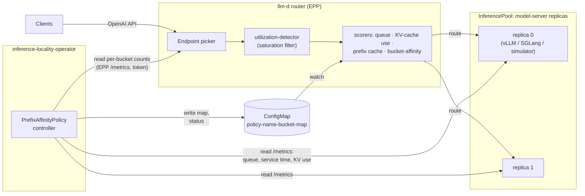

# inference-locality-operator

A Kubernetes operator that decides **where inference state lives** in an [llm-d](https://llm-d.ai) pool and
**routes requests to it**: prompt-prefix buckets owned by model-server replicas and rebalanced, with their cached
state, when a replica is overloaded (`PrefixAffinityPolicy`), and shelf-life placement for state kept outside the
GPU (`CachePolicy`, later).

The design carries two edge-storage systems over to inference serving: **ReStorEdge** (bucket ownership and
rebalancing together with the data) and **SEND** (placement by popularity and function, shelf lives with archive or
delete on expiry). See [ARCHITECTURE.md](ARCHITECTURE.md) for the design and the papers, and [PREP.md](PREP.md) for
the environment and order of work. The workload and evaluation come from
[code-doc-assistant](https://github.com/Chrisys93/code-doc-assistant).

**Status (2026-11-24):** simulator baseline run; `PrefixAffinityPolicy` controller and `bucket-affinity-scorer` (EPP plugin, `epp/`) implemented; rebalancing moves the busiest buckets using the scorer's counts, compared with index-order moves on the simulators. Next: warming a bucket's new owner, then the GPU measurement.

## Getting Started

### Prerequisites
- Go 1.27 (tested with 1.27.4), kubebuilder v4.16.0
- Docker, kubectl
- A Kubernetes 1.37 cluster (developed on single-node minikube under WSL2) with the
  [Gateway API Inference Extension](https://github.com/kubernetes-sigs/gateway-api-inference-extension) CRDs and the
  llm-d router; see PREP.md

### Build and test
```sh
make manifests generate build test
```

### To Deploy on the cluster
Images are built locally, straight into the cluster's image store; nothing is pushed to a registry. On minikube
(the development cluster), build the binary on the host and the image inside minikube:

```sh
CGO_ENABLED=0 go build -o <dir>/manager cmd/main.go && cp hack/Dockerfile.prebuilt <dir>/Dockerfile
minikube image build -t inference-locality-operator:dev <dir>
```

`make deploy` writes the image into `config/manager/kustomization.yaml`; run
`git checkout config/manager/kustomization.yaml` afterwards. The scorer image (`epp/`) is built the same way; see
PREP.md, steps 3 and 4. To use a registry instead, `make docker-build docker-push IMG=<registry>/inference-locality-operator:<tag>`.

**Install the CRDs into the cluster:**

```sh
make install
```

**Deploy the Manager to the cluster with the image specified by `IMG`:**

```sh
make deploy IMG=inference-locality-operator:dev
```

> **NOTE**: If you encounter RBAC errors, you may need to grant yourself cluster-admin
privileges or be logged in as admin.

**Create a policy:**
The sample (`config/samples/routing_v1alpha1_prefixaffinitypolicy.yaml`) targets the simulator pool in namespace
`ilo-sim` (`hack/sim-baseline/`); change its `namespace`, `selector` and `scorerMetrics.service` for another pool.

```sh
kubectl apply -k config/samples/
kubectl -n ilo-sim get prefixaffinitypolicy        # Buckets, Map version, Moves
```

## Architecture

The operator works next to an [llm-d](https://llm-d.ai) router; it does not replace it. It owns one decision, which
replica a prompt prefix belongs to, and keeps that decision in a ConfigMap. A plugin inside the router's endpoint
picker (EPP) reads the map on every request, and the controller moves entries in it when a replica is overloaded.



| Component | Where | Role |
|---|---|---|
| `PrefixAffinityPolicy` (CRD) | `api/v1alpha1` | Which pods form the pool, how many buckets, the prefix length, the overload trigger, rebalancing limits, where the scorer's counters are |
| Controller | `internal/controller` | Each interval: reads the replicas' metrics, keeps the bucket map in step with the pods, moves buckets off overloaded replicas, writes the map and the status |
| Bucket map | `internal/buckets` | Bucket key of a prompt (FNV-1a over its first `prefix.bytes` bytes, modulo `buckets`), rendezvous-hashed owners, rebalancing |
| Metrics reader | `internal/metrics` | vLLM-format Prometheus metrics per replica, the scorer's per-bucket counters, differences between readings |
| `bucket-affinity-scorer` | `epp/` (own Go module) | Router plugin: scores the owner of a request's bucket 1, other replicas 0; counts requests, owner-served requests, prompt and cached tokens per bucket. Built into the stock llm-d EPP v1.0.0, no fork |
| `CachePolicy` (CRD) | planned | Placement and shelf life for state kept outside the GPU |

### How it works

- **Buckets, not prefixes.** A prompt's bucket is a hash of its first `prefix.bytes` bytes, so prompts sharing a
  long prefix (a system prompt, a document) land in the same bucket and the same replica, whose KV cache already
  holds that prefix. The map has a fixed number of buckets (`buckets`, default 64), so it stays small whatever the
  traffic.
- **Stable owners.** Owners are chosen by rendezvous hashing: each bucket goes to the pod with the highest hash of
  (bucket, pod name). A pod that joins takes only the buckets it wins (about 1/n); a pod that leaves hands its
  buckets to their next winners; nothing else moves, so caches elsewhere stay warm. Pod names are the owners, so
  model servers run best as a StatefulSet.
- **Overload trigger.** Each interval, per replica, from the difference between two metric readings: mean queueing
  delay against mean service time (`QueueDelay`, default: overloaded above 200%), or KV-cache use (`KVCacheUsage`,
  default 90%). A replica with fewer than `minRequests` completed requests in the interval is not judged.
- **Which buckets move.** With the scorer's counters (`scorerMetrics`), busiest bucket first, to the replica with the
  least expected load, and only if that replica stays no busier than the source afterwards; expected loads are
  updated after each move. A bucket bigger than half the gap stays put: moving it would only move the overload.
  Without counters, buckets move in index order to the coolest replicas in turn. Either way, at most
  `maxMovesPerInterval` per interval, a moved bucket stays put for `cooldown`, and no replica is drained below
  `minSharePercent` of its fair share.
- **Informed or not at all.** With `scorerMetrics` set but no counts for the interval (the first reading, or the
  EPP unreadable), nothing moves; the reason shows in `status.scorerMetricsError` and the log.
- **What a move costs.** The new owner starts with a cold cache for that bucket; its first requests recompute the
  prefix. Warming the new owner before the move is published is the next step.
- **Soft or strict routing.** At weight 3 the scorer is one opinion among several, and under load the router
  spills requests off a busy owner by itself (soft). At weight 10, with the router's saturation filter relaxed,
  requests follow the map and overload is left to the controller (strict). See "Deploying with the router".

### From the papers

The design carries two edge-storage systems over to inference serving (references in
[ARCHITECTURE.md](ARCHITECTURE.md)):

| Idea | Source | Here | State |
|---|---|---|---|
| Data grouped in hash buckets, each owned by one node, found through a forwarding table | ReStorEdge | Prefix-hash buckets, owned by replicas, map in a ConfigMap read by the EPP | Done |
| Queueing-delay trigger (queueing above twice the service time) | ReStorEdge; thesis Alg. 2 | `trigger.type: QueueDelay`, `queueDelayPercent: 200` | Done |
| Workload orchestration: busiest bucket to the least-loaded node, expected loads updated per move | Thesis Alg. 4 (5.2.5) | `scorerMetrics` set | Done |
| Moving a bucket together with its data | ReStorEdge | Warming the new owner's KV cache (replaying the bucket's prefixes; later, KV transfer) | Planned |
| Splitting a bucket more popular than a node's fair share | Thesis 5.5 | Replicating a bucket over several owners | Planned |
| Hybrid placement: function proximity first, then popularity; the nodes interested in the data | SEND; thesis 4.4.4 | Weighing buckets by load, cached share and trend, per replica | Planned |
| Shelf life with archive or delete on expiry | SEND | `CachePolicy`: offloaded KV, checkpoints, indices | Planned |

On the simulators, moving the busiest buckets that fit settled an overloaded replica in one interval with 3-4 moves,
where index-order moves took 32-36 and kept drifting (ARCHITECTURE.md, run rebalance-004). Simulator latencies are
configured values; GPU measurements are next.

### Configuration

`PrefixAffinityPolicy` spec (defaults from the CRD):

| Field | Default | Meaning |
|---|---|---|
| `selector` | required | Label selector for the model-server pods (as the InferencePool selects them) |
| `metricsPort`, `metricsPath` | `8000`, `/metrics` | Where each replica serves vLLM-format metrics |
| `buckets` | `64` (1-4096) | Number of prefix-hash buckets |
| `prefix.bytes` | `2048` (min 16) | Leading prompt bytes that define the bucket; must cover the shared part of your prompts |
| `trigger.type` | `QueueDelay` | `QueueDelay` or `KVCacheUsage` |
| `trigger.queueDelayPercent` | `200` | Overloaded when mean queueing delay exceeds this percentage of mean service time |
| `trigger.kvCacheUsagePercent` | `90` (1-100) | Overloaded above this KV-cache use (`KVCacheUsage`) |
| `trigger.minRequests` | `20` | Completed requests needed in an interval to judge a replica |
| `rebalance.interval` | `30s` | Time between readings and decisions |
| `rebalance.maxMovesPerInterval` | `4` | Cap on moves per interval; `0` observes without moving |
| `rebalance.minSharePercent` | `25` (0-100) | Floor: a replica keeps this share of its fair share of buckets, and at least one |
| `rebalance.cooldown` | `2m` | Time a moved bucket stays with its new owner |
| `rebalance.priority` | `Load` | With `scorerMetrics`: `Load` moves the busiest bucket that fits first; `LoadAndReuse` ranks by load × (1 − cached share), so a busy bucket whose requests share little moves before one whose prefixes are reused |
| `scorerMetrics.service` | unset | The EPP's Service in the policy's namespace; set it to move busiest buckets first |
| `scorerMetrics.port`, `.path` | `9090`, `/metrics` | The EPP's metrics endpoint |
| `scorerMetrics.auth` | `None` | `ServiceAccountToken` sends the controller's token (the EPP checks tokens by default); never sent to an ExternalName Service |

Status: `bucketMap` (the ConfigMap's name), `mapVersion`, `totalMoves`, `lastRebalanceTime`, per replica (buckets,
requests, mean queue and service milliseconds, KV-cache use, overloaded, scrape error), with `scorerMetrics` the
eight busiest buckets (owner, requests, cached and owner-served percentages) and `scorerMetricsError`, and a `Ready`
condition. The map itself is `map.json` in the ConfigMap: version, hash, bucket count, prefix bytes, owner per
bucket, move times.

`bucket-affinity-scorer` parameters: `configMap` (required, `<policy>-bucket-map`) and `namespace` (default: the
EPP's own). The EPP needs a Role allowing `get`, `list` and `watch` on that one ConfigMap
(`hack/sim-baseline/epp-bucket-map-rbac.yaml`).

Controller: the standard kubebuilder flags (`--leader-elect`, `--metrics-bind-address`, `--health-probe-bind-address`,
`--metrics-secure`); leader-election leases are 60 s (renew deadline 45 s), long enough to ride out a slow API
server on a small cluster. `make deploy` also binds the `metrics-reader` ClusterRole to the controller's service
account, which is what lets its token read the EPP's metrics.

### Deploying with the router

The router is the stock llm-d router chart (`llm-d-router-standalone` v1.0.0) with the EPP image swapped for one that
includes the scorer (built from `epp/`, see PREP.md step 4). Starting from a pool already served by the router:

```sh
# 1. The EPP may read the bucket map
kubectl apply -f hack/sim-baseline/epp-bucket-map-rbac.yaml

# 2. Router with the scorer. Soft (weight 3, the router may spill load off a busy owner):
helm upgrade router oci://ghcr.io/llm-d/charts/llm-d-router-standalone --version v1.0.0 -n ilo-sim \
  -f hack/sim-baseline/router-values.yaml -f hack/sim-baseline/router-values-r2.yaml
#    or strict (weight 10, saturation filter relaxed; requests follow the map, the controller handles overload):
helm upgrade router oci://ghcr.io/llm-d/charts/llm-d-router-standalone --version v1.0.0 -n ilo-sim \
  -f hack/sim-baseline/router-values.yaml -f hack/sim-baseline/router-values-r2-strict.yaml

# 3. The policy, with scorerMetrics pointing at the EPP's Service
kubectl apply -k config/samples/

# 4. Watch it
kubectl -n ilo-sim get prefixaffinitypolicy sim-pool -o yaml          # status: replicas, busiestBuckets
kubectl -n ilo-sim get configmap sim-pool-bucket-map -o jsonpath='{.data.map\.json}'
kubectl -n inference-locality-operator-system logs deploy/inference-locality-operator-controller-manager | grep 'bucket moved'
```

Why strict needs the relaxed filter: the router's `utilization-detector` removes a replica with 5 or more waiting
requests, or 80% KV-cache use, before any scorer runs, so under load it decides instead of the weights. The strict
values keep it only as a last resort (64 waiting requests, KV cache over 100%).

The simulator pool, load generator and comparison scripts are in `hack/sim-baseline/`; PREP.md has the full order
of work and ARCHITECTURE.md the measurements.

## To Uninstall
**Delete the instances (CRs) from the cluster:**

```sh
kubectl delete -k config/samples/
```

**Delete the APIs(CRDs) from the cluster:**

```sh
make uninstall
```

**UnDeploy the controller from the cluster:**

```sh
make undeploy
```

## Project Distribution

Following the options to release and provide this solution to the users.

### By providing a bundle with all YAML files

1. Build the installer for the image built and published in the registry:

```sh
make build-installer IMG=<some-registry>/inference-locality-operator:tag
```

**NOTE:** The makefile target mentioned above generates an 'install.yaml'
file in the dist directory. This file contains all the resources built
with Kustomize, which are necessary to install this project without its
dependencies.

2. Using the installer

Users can just run 'kubectl apply -f <URL for YAML BUNDLE>' to install
the project, i.e.:

```sh
kubectl apply -f https://raw.githubusercontent.com/<org>/inference-locality-operator/<tag or branch>/dist/install.yaml
```

### By providing a Helm Chart

1. Build the chart using the optional helm plugin

```sh
kubebuilder edit --plugins=helm/v2-alpha
```

2. See that a chart was generated under 'dist/chart', and users
can obtain this solution from there.

**NOTE:** If you change the project, you need to update the Helm Chart
using the same command above to sync the latest changes. Furthermore,
if you create webhooks, you need to use the above command with
the '--force' flag and manually ensure that any custom configuration
previously added to 'dist/chart/values.yaml' or 'dist/chart/manager/manager.yaml'
is manually re-applied afterwards.

## Contributing

Issues and pull requests are welcome.

**NOTE:** Run `make help` for more information on all potential `make` targets

More information can be found via the [Kubebuilder Documentation](https://book.kubebuilder.io/introduction.html)

## License

Copyright 2026 The inference-locality-operator Authors.

Licensed under the Apache License, Version 2.0 (the "License");
you may not use this file except in compliance with the License.
You may obtain a copy of the License at

    http://www.apache.org/licenses/LICENSE-2.0

Unless required by applicable law or agreed to in writing, software
distributed under the License is distributed on an "AS IS" BASIS,
WITHOUT WARRANTIES OR CONDITIONS OF ANY KIND, either express or implied.
See the License for the specific language governing permissions and
limitations under the License.

